<h1 align="left" id="william-chung-title">👋 Hello there! I'm William </h1>
<h3 align="left">Full-Stack AI Developer + Data Engineer</h3>

  
  

- ✨ I build fast, useful AI-powered apps.
- ⚙️ I create smart automations and data workflows.
- 🌱 I learn and test new AI tools every day.
- 🚀 I enjoy turning ideas into working products quickly.
- ☁️ I'm an **[AWS Certified Cloud Practitioner]**.
- 📫 Ask me anything on my **[issues page]**.

 

<h2 align="left" id="william-chung-tech">Favorite Tech</h2>

> Languages, frameworks, data, and DevOps tools that I know and use.

<table>
  <tr>
    <td align="center" width="96">
      
       Python
    </td>
    <td align="center" width="96">
      
       JavaScript
    </td>
    <td align="center" width="96">
      
       Java
    </td>
    <td align="center" width="96">
      
       C++
    </td>
    <td align="center" width="96">
      
       C#
    </td>
  </tr>
  <tr>
    <td align="center" width="96">
      
       React
    </td>
    <td align="center" width="96">
      
       Next.js
    </td>
    <td align="center" width="96">
      
       Tailwind CSS
    </td>
    <td align="center" width="96">
      
       HTML5
    </td>
    <td align="center" width="96">
      
       CSS3
    </td>
  </tr>
  <tr>
    <td align="center" width="96">
      
       Node.js
    </td>
    <td align="center" width="96">
      
       Express
    </td>
    <td align="center" width="96">
      
       MongoDB
    </td>
    <td align="center" width="96">
      
       Docker
    </td>
    <td align="center" width="96">
      
       GitHub
    </td>
  </tr>
</table>

<h3 align="left">DevOps &amp; GitOps</h3>

<table>
  <tr>
    <td align="center" width="96">
      
       AWS
    </td>
    <td align="center" width="96">
      
       Kubernetes
    </td>
    <td align="center" width="96">
      
       Helm
    </td>
    <td align="center" width="96">
      
       GitHub Actions
    </td>
    <td align="center" width="96">
      
       Argo CD
    </td>
  </tr>
</table>

<h2 align="left">AWS Certification</h2>

> Verified credential from Credly.

<!--START_SECTION:badges-->

<!--END_SECTION:badges-->

<h2 align="left">Contribution Arena</h2>

> My GitHub contributions, turned into a game.

<h2 align="left">Let's Connect</h2>

  
  

<!-- Links -->

[AWS Certified Cloud Practitioner]: https://www.credly.com/badges/cf374089-953a-4673-b2df-7f7b55c5e8cc "William Chung's AWS credential"
[issues page]: https://github.com/Krinkrinnnnn/Krinkrinnnnn/issues "Krinkrinnnnn profile issues"
